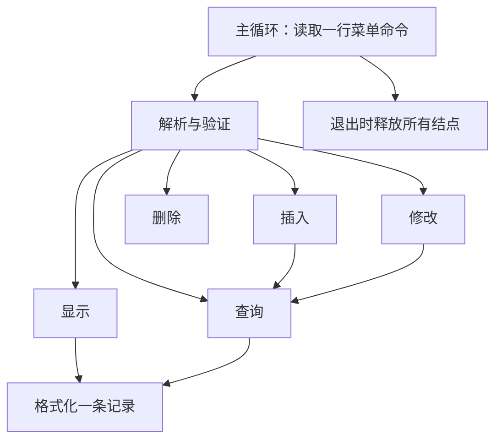

# 六次上机实验：从原报告到可运行实践

来源S6《C语言程序设计上机实验报告.pdf》，52页。**原PDF已完整放入raw**。共6次实验，按“实验内容”一级编号计26项，其中21项必做、5项选作；实验4(2)内的两个示例仍合计为1项。代码清单是否满足题意另行检查，不能因为印在报告里就默认正确。

本仓库提供重写教学实现与报告模板，不替你虚构上机截图、运行经历或手写签名。原报告实验6要求手写注释/手绘调用图；仓库提供可参考的文字与图，正式提交形式以老师要求为准。

## 实验对应表

|实验/页码|原任务|对应代码与说明|
|---|---|---|
|1 p1–7|1闰年|33给闰年与日期；只需闰年时取leap函数|
|1|2二次方程|37，含a=0退化情况|
|1|3十人五科均分|43，额外输出每科均分与最大成绩|
|1|4水仙花|06第二行；不需要输入时删除前半段数位练习|
|1|5选作文本文件均分|43使用输入输出重定向，见下文|
|2 p8–16|1指定多项式牛顿求根|38，原多项式、初值1.5，根为2|
|2|2十数选择排序|12第二行选择排序；用n=10|
|2|3二维数组鞍点|39，输出所有鞍点，含并列候选|
|2|4三个字符串中最大者|45，按字典序而非长度|
|2|5选作读姓名/三科、按总分排序、文本输出|42，输入固定10行；额外演示二进制|
|3 p17–26|1素数函数|08|
|3|2按指定原型复制元音|16思想；下文给原型对应的独立函数|
|3|3局部static|18、41；原清单误换为成绩统计|
|3|4全局数组与均/高/低分|41，按实验要求保留全局状态|
|3|5选作以函数拆分成绩文件流水线|42：read_text/write_binary/read_binary/sort/print|
|4 p27–36|1指针swap+冒泡|12的swap与bubble|
|4|2数组最大与my_atoi|10/17、40；40增加格式和溢出检查|
|4|3字符串拼接|15，有容量参数比原无界接口更明确|
|4|4动态分配数组|23的calloc/free；改成malloc后要逐个初始化，见10章|
|4|5选作文本转二进制、读回、排序再输出|42；原清单仅写随机数，未完成此题|
|5 p37–45|1比较两名学生|19可输入n=2；其版本比较三科均分，单科版见下面改写要求|
|5|2结构体数组成绩降序|19/42；单科结构删去多科数组即可|
|5|3结构体指针访问成员|19、20中的指针访问；`p->score`等于`(*p).score`|
|5|4建立/输出学生链表|20提供链表内存模板，44完整业务记录链表；改结点字段为学号和分数|
|5|5选作文本、二进制写入与读回|42与下面持久文件替换方案|
|6 p46–52|订餐信息插入/查询/修改/删除/显示|44：C链表版、C++11 vector版，均覆盖全部菜单功能|

上表明确哪些是原题同实现、哪些是合并/推广版本。不要把19的三科格式原样交成单科题；实验报告中应说明调整的数据结构和输入格式。

## 文件版怎么实际运行

仓库已提供`labs/data/grades10.txt`、`labs/data/five_courses.txt`和`labs/data/bookings.txt`。

```bash
mkdir -p build/labs
./build/c/43_five_courses < labs/data/five_courses.txt > build/labs/averages.txt
./build/c/42_grade_files < labs/data/grades10.txt > build/labs/ranking.txt
cat build/labs/ranking.txt
./build/c/44_reservations < labs/data/bookings.txt
./build/cpp/44_reservations < labs/data/bookings.txt
```

标准输入输出本身就是流；重定向后确实从文本文件读取并写入文本文件。42的C版用tmpfile做真实二进制文件往返，C++11版用二进制stringstream演示相同流接口。默认无参数模式不留下固定命名的二进制文件。现在两种语言都提供完整持久文件入口，无需改代码：

```bash
mkdir -p build/labs
./build/c/42_grade_files labs/data/grades10.txt build/labs/ranking-c.txt build/labs/raw-c.dat build/labs/sorted-c.dat
./build/cpp/42_grade_files labs/data/grades10.txt build/labs/ranking-cpp.txt build/labs/raw-cpp.dat build/labs/sorted-cpp.dat
diff build/labs/ranking-c.txt build/labs/ranking-cpp.txt
```

四个参数依次是输入文本、输出文本、原序二进制、排序二进制；终端同时显示排序结果。输出文件会覆盖同名练习文件，四个路径必须不同。C版使用fopen/fwrite/fread，C++11版使用ifstream/ofstream和read/write，检查打开、读写和关闭状态。

二进制格式是每条20字节姓名字段+3个本机int，不跨实现承诺可移植。清零未使用姓名字节，避免写出未初始化尾部。读取任意外部二进制文件还需要格式校验；42只读自己刚写出的数据。

## 指定原型与接口约束

实验3(2)指定`void cpy(char s1[],char s2[])`。在调用者保证目标容量不小于源长度+1时，可写：

```c
void cpy(char s1[], char s2[]) {
    size_t j=0;
    for(size_t i=0;s1[i]!='\0';++i)
        if(strchr("aeiouAEIOU",(unsigned char)s1[i])!=NULL)
            s2[j++]=s1[i];
    s2[j]='\0';
}
```

需要string.h。工程版本可把源设为const并增加目标容量和状态返回值；若老师固定签名，先满足签名并在报告中写清前提。

实验5单科记录：`struct Student { int id; char name[20]; double score; };`。比较时明确同分政策；若题目要求两人同分都输出，就不能沿用19“第一位最高者”的政策。建立学生链表时每个malloc都检查，输入失败释放已有链表；用20的销毁和二级指针模式迁移，而非原清单中先分配未使用哨兵后遗忘释放。

## 订餐综合项目

执行`./build/c/44_reservations`后每行输入一条命令：

|命令|示例|效果|
|---|---|---|
|1 编号 姓名 人数 时间|`1 101 Li 3 18:30`|插入；重复编号DUPLICATE|
|2 编号|`2 101`|查询；找不到NOT_FOUND|
|3 编号 人数 时间|`3 101 4 19:00`|修改人数与时间|
|4 编号|`4 101`|删除；C版立即free|
|5|`5`|显示所有记录，空表EMPTY|
|6|`6`|退出并释放全部记录|

输入顺序与原报告交互提示不同，但业务功能一致。编号正整数、人数1..1000、姓名<=31字节且无空格、时间HH:MM且范围合法。输入词法应是可由int表示的整数；菜单不是通用对抗性输入解析框架。无效命令不会破坏已有记录。EOF也正常清理资源。



C++11版用vector保持插入顺序，按编号线性查找；删除移动后续元素。C链表版只重新接链并释放结点。两者查找都是O(n)，不要误以为链表查找更快。

## 每次实验的报告结构

1. 目的：用自己的话写本次要掌握的语言与算法概念。
2. 题目和约束：输入、输出、范围、并列/空数据政策。
3. 算法：流程图、状态变量、终止条件、复杂度。
4. 程序：自己完成的C99代码，加解释“为什么”的注释。
5. 实际运行：正常、边界、错误输入至少各一组，记录真实结果。
6. 问题与修复：错误现象→最小反例→原因→修改→复测。
7. C++11对照：哪些对象交给容器管理，算法是否改变。

空白模板见[labs/report_template.md](../labs/report_template.md)。
